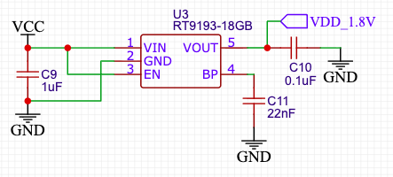
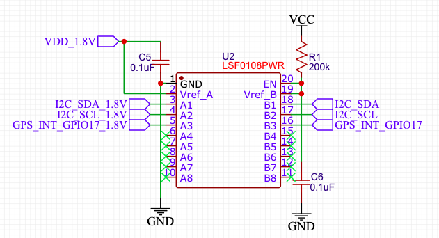
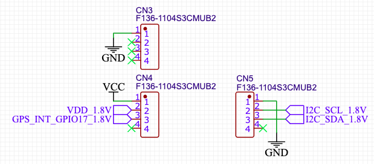

# I2C setup

English | [日本語](ja/setup.md)

[README](../README.md) · [Python and C API](api.md) · [UART](uart.md)

These instructions cover Raspberry Pi OS Trixie or later and the
**Spresense GNSS Add-on Board** (CXD5602PWBGNSS1W, CXD5610GF).
The tested connection uses a Raspberry Pi Zero 2 W, I2C at 400 kHz and GPIO17.

## 1. Install system dependencies

```sh
sudo apt install build-essential python3-dev python3-venv libgpiod-dev gpiod
sudo usermod -aG i2c,gpio "$USER"
```

The group changes take effect after the reboot below. Python 3.13+ and
libgpiod 2.0+ are required; pip installs the Python build dependencies.

## 2. Connect the board

Connect **I2C SDA, I2C SCL and IRQIN** through level shifting between the board's
**1.8 V** signals and the Raspberry Pi's **3.3 V** signals.
The circuit example uses an RT9193-18GB regulator, an LSF0108PWR level translator
and three four-pin sockets.

Across all three diagrams, `VCC` means the Pi's **3.3 V** supply (physical pin
1 or 17), and `VDD_1.8V` means the regulator's **1.8 V** output. Connect matching
signal labels together and share GND between the Pi, regulator, translator and
GNSS board.

### Generate the 1.8 V supply

For RT9193-18GB (U3), connect VIN (pin 1) and EN (pin 3) to 3.3 V, and GND
(pin 2) to ground. VOUT (pin 5) supplies 1.8 V to the GNSS board and the
LSF0108 reference input. C9 is 1 µF; the BP capacitor C11 is 22 nF.



**C10 correction:** the diagram shows 0.1 µF. Use **at least 1 µF of ceramic
output capacitance** between VOUT and GND, close to the regulator. Meet the
capacitance and ESR stability requirements in the
[RT9193 datasheet, Applications Information](https://www.richtek.com/assets/product_file/RT9193/DS9193-18.pdf#page=8).

### Level-shift the three signals

The tested circuit uses an
[LSF0108PWR](https://www.ti.com/product/LSF0108/part-details/LSF0108PWR) (U2).
Connect the A side to the GNSS board and the B side to the Raspberry Pi.



| Signal | A side: GNSS board | B side: Raspberry Pi |
| --- | --- | --- |
| SDA | A1, pin 3: `I2C_SDA_1.8V` | B1, pin 18: `I2C_SDA` → GPIO2 |
| SCL | A2, pin 4: `I2C_SCL_1.8V` | B2, pin 17: `I2C_SCL` → GPIO3 |
| IRQIN | A3, pin 5: `GPS_INT_GPIO17_1.8V` | B3, pin 16: `GPS_INT_GPIO17` → GPIO17 |

Connect Vref_A (pin 2) to 1.8 V and GND (pin 1) to common ground. Tie Vref_B
(pin 19) and EN (pin 20) together, then connect that node to 3.3 V through
R1 (200 kΩ). C5 and C6 are 0.1 µF. Leave A4–A8 and B4–B8 unconnected.

**Signal pull-ups are omitted from the diagram.** Each B-side signal needs a
pull-up to 3.3 V:

- I2C B side: use the Pi Zero 2 W's existing 1.8 kΩ pull-ups on GPIO2/GPIO3;
  see the [Pi schematic](https://datasheets.raspberrypi.com/rpizero2/raspberry-pi-zero-2-w-reduced-schematics.pdf).
- I2C A side: use the GNSS board's existing 4.7 kΩ pull-ups to 1.8 V (R6/R7);
  see the [Sony schematic](https://github.com/sonydevworld/spresense-hw-design-files/blob/master/CXD5602PWBGNSS1/schematics/CXD5602PWBGNSS1_schematics.pdf).
- IRQIN B side (`GPS_INT_GPIO17`): provide an external pull-up to 3.3 V.
  The driver does not enable GPIO17's internal pull-up.

Size pull-ups for the bus capacitance, rise time and driver sink current using
[TI's Pull-Up Resistor Sizing guidance](https://www.ti.com/lit/ds/symlink/lsf0108.pdf#page=15).
The 200 kΩ R1 biases Vref_B/EN; it does not replace the signal pull-ups.

### Connect the sockets

The example uses three **F136-1104S3CMUB2** four-pin sockets. **CN3/CN4/CN5 in
this diagram are socket names**, distinct from CN1/CN2 on the GNSS board.



| Socket | GNSS board pins, in socket pin 1→4 order | Signals, in the same order |
| --- | --- | --- |
| CN3 | CN1 pins 1, 2, 3, 4 | GND, unconnected, unconnected, unconnected |
| CN4 | CN1 pins 10, 11, 12, 13 | 3.3 V, 1.8 V, IRQIN, unconnected |
| CN5 | CN2 pins 10, 11, 12, 13 | GND, I2C SCL, I2C SDA, unconnected |

On Sony's [component-side pinout](https://developer.spresense.sony-semicon.com/products/gnss-add-on-board),
CN1 is on the left, CN2 is on the right, and pin 1 is at the top. Both connectors
have 13 pins. Check socket orientation against this mapping; green crosses in
the diagram mark unconnected pins.

| Signal / supply | GNSS board pin | Pi GPIO / supply | Pi physical pin | Connection |
| --- | --- | --- | --- | --- |
| SDA | CN2-12 (D14) | GPIO2 / SDA1 | 3 | 3.3 V ↔ 1.8 V translation |
| SCL | CN2-11 (D15) | GPIO3 / SCL1 | 5 | 3.3 V ↔ 1.8 V translation |
| IRQIN | CN1-12 (D22) | GPIO17 input | 11 | Board 1.8 V output → Pi 3.3 V input |
| GND | CN1-1 and CN2-10 | GND | e.g. 6 | Common ground |
| 1.8 V | CN1-11 | RT9193 output, `VDD_1.8V` | — | Board power |
| 3.3 V | CN1-10 | 3.3 V | 1 or 17 | Board power, including antenna supply |

`IRQIN` is the board's signal name for notifications from GNSS to the host;
configure the Pi side as an input. GPIO numbers above are BCM numbers, separate
from physical header pin numbers.

## 3. Enable I2C at 400 kHz

The clock is configured by Raspberry Pi OS and applies to all devices on the
same I2C bus. Back up and open the boot configuration:

```sh
sudo cp -an /boot/firmware/config.txt /boot/firmware/config.txt.before-cxd56xx
sudo nano /boot/firmware/config.txt
```

Set these lines near the beginning, before conditional sections such as `[pi5]`
or `dtoverlay` directives. Edit existing entries instead of adding duplicates.

```ini
dtparam=i2c_arm=on
dtparam=i2c_arm_baudrate=400000
```

Reboot, reconnect, and check the frequency reported by the device tree:

```sh
sudo reboot
```

```sh
python3 - <<'PY'
from pathlib import Path

path = Path("/sys/bus/i2c/devices/i2c-1/of_node/clock-frequency")
print(int.from_bytes(path.read_bytes(), "big"), "Hz")
PY
```

Expect `400000 Hz`. Change `i2c-1` if using another bus. References:
[Raspberry Pi DT parameters](https://www.raspberrypi.com/documentation/computers/configuration.html#dt-parameters),
[NuttX's 400 kHz setting](https://github.com/apache/nuttx/blob/87f134cfaa9e1474515deffb1e1224ab16f5b48e/boards/arm/cxd56xx/common/src/cxd56_gnss_addon.c#L46)
and [REYAX Software Guide §2.2](https://reyax.com/upload/products_download/download_file/RYS8839_Software_Guide.pdf#page=8).

## 4. Select the GPIO chip and install from PyPI

| Setting | Default | Build setting |
| --- | --- | --- |
| I2C device | `/dev/i2c-1` | `CXD5610_I2C_DEV` macro |
| 7-bit I2C address | `0x24` | `CXD5610_I2C_ADDR` macro |
| GPIO chip | `/dev/gpiochip4` | `CXD56XX_GPIO_CHIP` environment variable |
| Interrupt line offset | `17` | `CXD5610_INT_GPIO` macro |

Chip numbering varies by board and OS. Identify the chip containing GPIO17 and
its line offset:

```sh
gpiodetect
gpioinfo
```

For example, if it is `/dev/gpiochip0`:

```sh
python3 -m venv .venv
. .venv/bin/activate
CXD56XX_GPIO_CHIP=/dev/gpiochip0 python -m pip install --no-cache-dir rpi-cxd56xx-gnss
cxd56xx-gnss
```

The reader prints time, coordinates, fix status and satellite counts. Stop it
with **Ctrl+C**. Position the antenna with a clear view of the sky to obtain a fix.

The GPIO choice is compiled into the driver. To change it, rebuild from source:

```sh
CXD56XX_GPIO_CHIP=/dev/gpiochip0 python -m pip install \
  --force-reinstall --no-cache-dir --no-binary=rpi-cxd56xx-gnss rpi-cxd56xx-gnss
```

Changing only the OS I2C clock does not require rebuilding. Other defaults in
[cxd5610_rpi.h](../src/cxd56xx_gnss/cxd5610_rpi.h) can be overridden with compiler
`-D` flags; see [building from a checkout](api.md#building-from-a-checkout).
